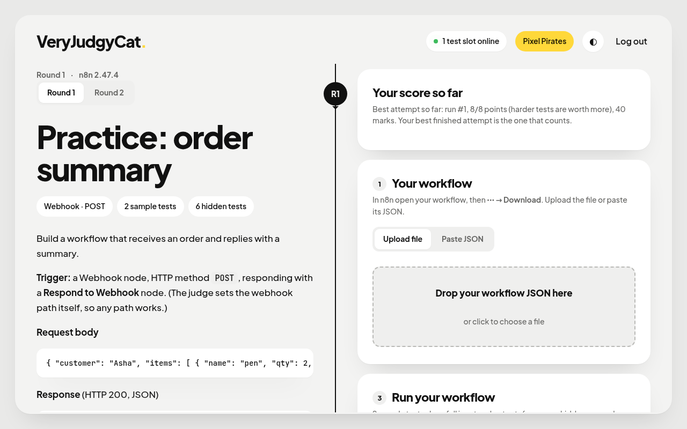
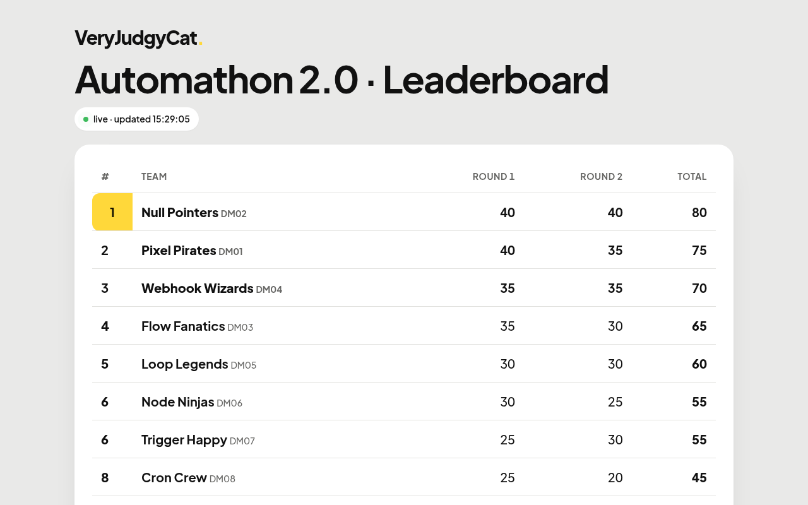
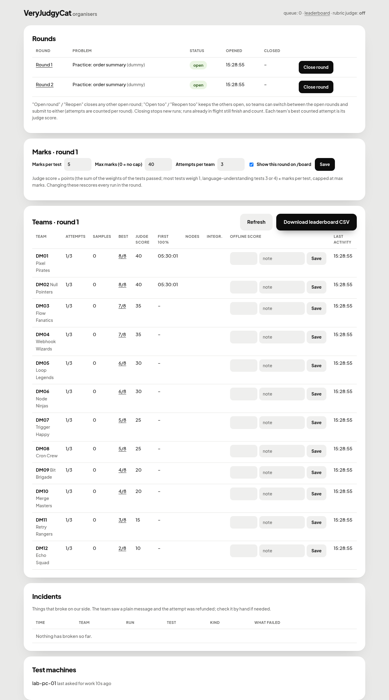

# VeryJudgyCat

A LeetCode-style judge for **n8n workflows**. Teams upload an exported workflow; the judge runs it in a fresh,
throw-away n8n container against hidden tests and shows a verdict per sample test plus how many hidden tests passed.
Built for the Automathon 2.0 hackathon, usable for any workflow contest or course.

- **Real n8n, real runs.** Every run gets a fresh n8n 2.47.4 container, so a workflow is judged the way it would behave in production.
- **Simulated services.** Telegram, Google Calendar, Sheets and Gmail are faked inside the judge network, so tests never message real people or touch real accounts.
- **Rounds, attempts, leaderboard.** Free sample runs, a limited number of scored attempts per round (best counts), several rounds open at once, marks per test, offline scores, a public `/board` and a CSV export.
- **AI-aware grading.** Checks can be exact (status, JSON paths, latency) or graded by an LLM against a rubric, with provider failover. Grader outages are refunded, never scored as zero.
- **Scales out.** One Go binary runs the site, the test machines (`worker`) and the organiser tools. Workers only make outbound HTTPS calls, so lab PCs behind NAT work.
- **Safe by default.** Team API keys live only in memory, hidden tests never reach teams, and containers run with `--cap-drop ALL` and `no-new-privileges`.

## Screenshots

Taken from a demo instance with made-up teams.

| Team page | Leaderboard |
|---|---|
|  |  |



## Try it locally

You need Go 1.27+ and Docker.

```bash
CGO_ENABLED=0 go build -o bin/judge ./cmd/judge     # must be static
bin/judge bake                                      # builds the judge n8n image (~2 min, once)

# run the bundled example workflow against the example problem
bin/judge check --problem problems/0-dummy --workflow problems/0-dummy/ideal.json -v

# start the site (admin pages at /admin)
export JUDGE_ADMIN_PASSWORD=change-me JUDGE_WORKER_TOKEN=change-me-too
bin/judge serve --rounds 1=dummy --local-pool 2
bin/judge teams --db judge.db --count 5 --out teams.csv    # creates logins (teams.csv is gitignored)
```

Open <http://127.0.0.1:8080>, sign in with a team from `teams.csv`, and upload `problems/0-dummy/ideal.json`.
`--rounds` maps a round number to a problem `id` (the `id:` field in its `problem.yaml`).

## Commands

| Command | What it does |
|---|---|
| `judge bake` | Pulls n8n and builds the judge images (n8n + simulators) on this machine |
| `judge check` | Runs one workflow against one problem locally, with `--times N` and `-v` |
| `judge serve` | Central site: team pages, admin, queue, leaderboard, worker API |
| `judge worker` | A test machine that pulls runs from a central site (`--central`, `--token`, `--pool`) |
| `judge teams` | Creates team logins and writes `teams.csv` (keep it private) |

## Writing a problem

A problem is a folder under `problems/`:

```
problems/<dir>/
  problem.yaml     id, title, trigger (webhook / telegram), entries, limits
  statement.md     what teams see: the contract only
  tests/*.yaml     sample (visible) and hidden tests
  ideal.json       a reference workflow that must pass everything
```

Tests have seeded random `vars`, computed `let` values, one or more steps, and `expect` checks (status, JSON paths,
substrings, latency, simulator side effects, or an LLM `rubric`). Rendering is deterministic per seed, so expected values are
never stored or sent to workers. [`problems/0-dummy`](problems/0-dummy) uses every feature; always prove your reference workflow passes:

```bash
bin/judge check --problem problems/<dir> --workflow problems/<dir>/ideal.json --times 3
```

For the LLM grader, point `JUDGE_LLM_CONFIG` at a JSON list of providers (each with `base`, `model`, `key_file`), or use
`JUDGE_LLM_BASE` + `JUDGE_LLM_MODEL` + `JUDGE_LLM_KEY`. Nothing is guessed from a key prefix.

## How it works

```
 team browser ──► central site (Go, SQLite) ──queue──► workers ──► fresh n8n container
                       │  admin, /board, CSV                         └─► simulators (Telegram, Google)
                       └─ grader (LLM, optional)
```

- `internal/workflow` parses an export, finds the trigger, checks node types against the n8n catalog, detects needed credentials and hardcoded keys.
- `internal/runner` manages the container pool and runs tests through n8n's public API.
- `internal/problem` loads problems and renders tests. `internal/grade` turns results into verdicts.
- `internal/mock` is the fake Telegram/Google backend. `internal/server` is the site, admin and worker API.

## Running an event

- [`docs/RUNBOOK.md`](docs/RUNBOOK.md): central machine, tunnel, workers, admin and troubleshooting.
- [`HANDBOOK.md`](HANDBOOK.md): the event-day checklist.
- `deploy/start-central.sh` starts the site (and a Cloudflare tunnel); `deploy/make-bundle.sh` builds an offline installer for Docker-less lab PCs.

Real event problem packs and hidden tests are deliberately not in this repository; keep yours out of git too (`problems/*` is gitignored except the example).

## Development

```bash
gofmt -l . && go vet ./... && go test ./...
```

## Known limitations

This is a personal/college-stage project, not hardened for the open internet.

- Judge containers share one Docker network and have no egress filtering, so a workflow can reach the worker's LAN. Run workers on an isolated network.
- The simulated Sheets backend has no size caps.
- A workflow can influence whether a run counts as rate-limited (and so refunded).
- Python Code nodes are not supported; OAuth credentials are rejected except for the simulated services.
